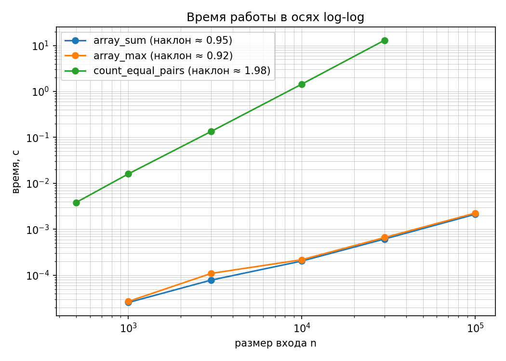
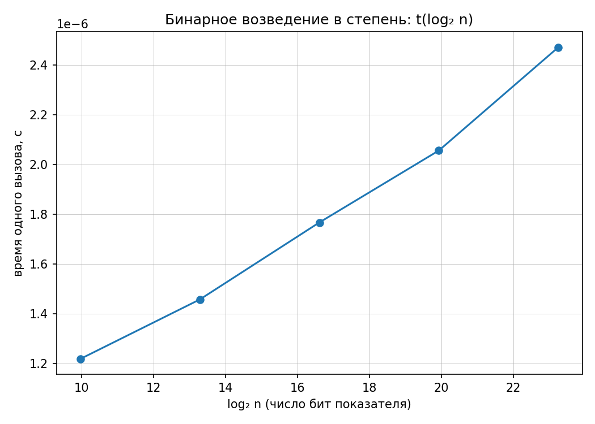

# Лабораторная работа №1
## Анализ временной сложности элементарных алгоритмов

Вариант: 1
Seed: 31
Язык программирования: Python 3.11.9

## 1. Цель работы

Научиться определять временную сложность алгоритмов
аналитически и подтверждать полученные оценки
экспериментальными измерениями. 

## 2. Аналитическая оценка сложности

### 2.1. Сумма элементов массива

Алгоритм последовательно обрабатывает все n элементов
массива, выполняя одно сложение на каждой итерации.

Временная сложность: Θ(n).
Дополнительная память: O(1).

Инвариант: после обработки первых k элементов
переменная total содержит их сумму.

### 2.2. Поиск максимального элемента

Первый элемент принимается за текущий максимум.
Остальные n-1 элементов последовательно сравниваются с ним.

Временная сложность: Θ(n).
Дополнительная память: O(1).

Инвариант: после обработки первых k элементов
maximum содержит наибольший среди них.

### 2.3. Подсчёт равных пар

Алгоритм перебирает все пары индексов i < j.

Количество сравнений:

C(n) = n(n-1)/2

Временная сложность: Θ(n²).
Дополнительная память: O(1).

Инвариант: после каждого сравнения count равен
числу равных пар среди уже проверенных пар.

### 2.4. Бинарное возведение в степень

На каждой итерации показатель степени делится на два,
а основание возводится в квадрат.

Количество итераций при n > 0:

floor(log₂(n)) + 1

Временная сложность: Θ(log n), при n >= 2
и фиксированной стоимости арифметических операций.
Дополнительная память: O(1) в модели RAM.

Инвариант: произведение result * base^n сохраняет
значение исходной степени (при наличии модуля —
сохраняет равенство по модулю).

## 3. Методика эксперимента

Вариант: 1.
Seed генератора: 31.
Язык: Python 3.11.9.

Данные сгенерированы средствами репозитория.

Каждый эксперимент включает один прогревочный запуск
и пять измерений. В качестве результата используется
медиана времени выполнения.

Для бинарного возведения в степень применяются
модуль 1000000007 и серия из 20000 вызовов на замер.

## 4. Результаты измерений

### 4.1. Линейные алгоритмы

| n | array_sum, с | array_max, с |
|---:|---:|---:|
| 1000 | 0.000026 | 0.000027 |
| 3000 | 0.000078 | 0.000109 |
| 10000 | 0.000204 | 0.000218 |
| 30000 | 0.000615 | 0.000661 |
| 100000 | 0.002120 | 0.002250 |

### 4.2. Подсчёт равных пар

| n | Время, с |
|---:|---:|
| 500 | 0.003841 |
| 1000 | 0.016076 |
| 3000 | 0.134698 |
| 10000 | 1.444569 |
| 30000 | 13.039668 |

### 4.3. Бинарное возведение в степень

| Показатель n | Время одного вызова, с |
|---:|---:|
| 1000 | 0.000001219 |
| 10000 | 0.000001458 |
| 100000 | 0.000001767 |
| 1000000 | 0.000002056 |
| 10000000 | 0.000002471 |

### 4.4. Экспериментальные наклоны log-log

| Алгоритм | Теория | Эксперимент |
|---|---:|---:|
| array_sum | 1 | 0.947 |
| array_max | 1 | 0.924 |
| count_equal_pairs | 2 | 1.978 |

## 5. Графики

### 5.1. Степенные зависимости

### 5.2. Бинарное возведение в степень

