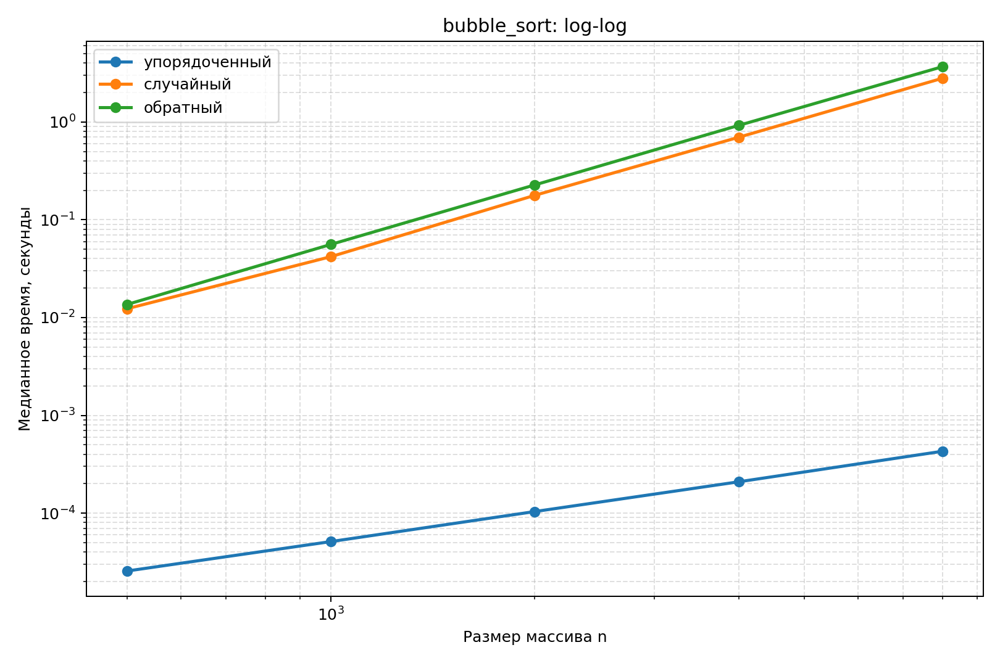
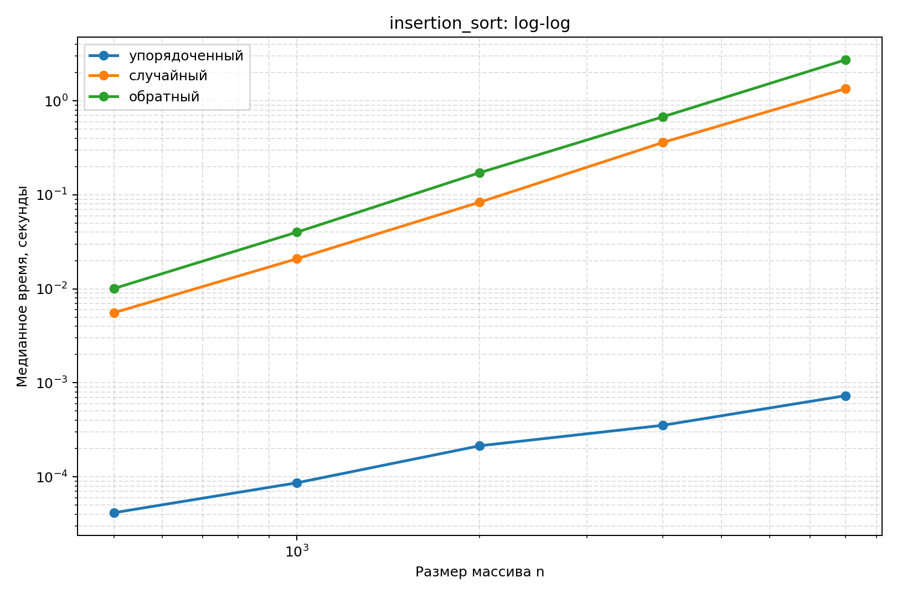
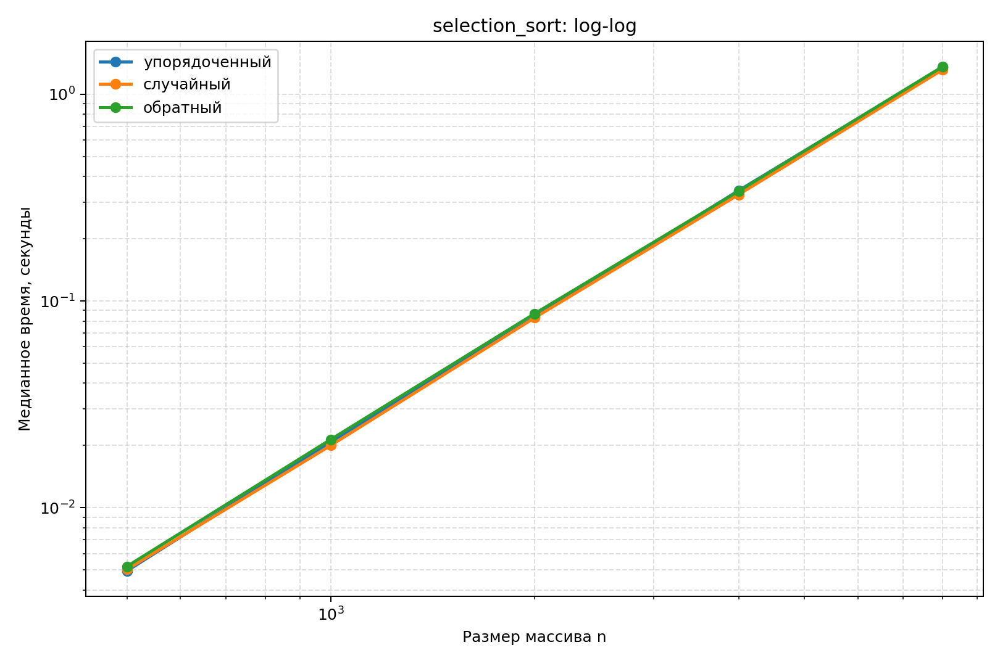
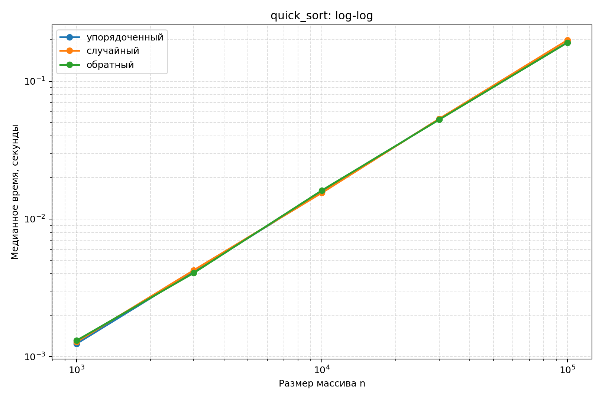

# Лабораторная работа №3

## Экспериментальное сравнение простых сортировок. QuickSort с рандомизацией опорного элемента

- **Вариант:** 1
- **Seed генератора:** 31
- **Язык программирования:** Python 3.11.9
- **Процессор:** AMD64 Family 25 Model 80 Stepping 0, AuthenticAMD
- **Операционная система:** Windows

## 1. Цель работы

Изучить принципы работы простых алгоритмов сортировки и быстрой сортировки QuickSort с рандомизированным выбором опорного элемента.

Реализовать алгоритмы пузырьковой сортировки, сортировки вставками, сортировки выбором и QuickSort. Исследовать их производительность на упорядоченных, случайных и обратно упорядоченных массивах различных размеров.

Экспериментально проверить теоретические оценки временной сложности, сравнить стабильность алгоритмов, выполнить верификацию реализаций и проанализировать полученные результаты.

## 2. Аналитическая оценка сложности алгоритмов

### 2.1. Сортировка пузырьком (Bubble Sort)

Алгоритм последовательно сравнивает соседние элементы массива и меняет их местами, если они расположены в неправильном порядке. После каждого прохода наибольший из оставшихся элементов перемещается в конец неотсортированной части массива.

В реализации предусмотрен досрочный выход: если за проход не произошло ни одного обмена, массив уже отсортирован.

**Оценка сложности:**

- Лучший случай: Θ(n) — массив уже отсортирован.
- Средний случай: Θ(n²).
- Худший случай: Θ(n²) — массив расположен в обратном порядке.
- Дополнительная память: O(n) с учётом создания копии входного массива.

Досрочное завершение позволяет существенно ускорить алгоритм на упорядоченных данных.

### 2.2. Сортировка вставками (Insertion Sort)

Алгоритм последовательно рассматривает элементы массива и вставляет каждый очередной элемент в правильную позицию среди уже обработанных элементов. Для этого элементы, превосходящие вставляемое значение, сдвигаются вправо.

**Оценка сложности:**

- Лучший случай: Θ(n) — массив уже отсортирован.
- Средний случай: Θ(n²).
- Худший случай: Θ(n²) — обратный порядок.
- Дополнительная память: O(n) с учётом копии массива.

Алгоритм эффективен на небольших и почти отсортированных массивах. Его преимущество заключается в небольшом количестве операций при наличии малого числа инверсий.

### 2.3. Сортировка выбором (Selection Sort)

На каждой итерации алгоритм находит минимальный элемент неотсортированной части массива и меняет его местами с первым элементом этой части.

Количество сравнений не зависит от исходного расположения элементов.

Для массива длины n количество сравнений определяется выражением:

\[
C(n) = (n-1) + (n-2) + \ldots + 1 = \frac{n(n-1)}{2}
\]

**Оценка сложности:**

- Лучший случай: Θ(n²).
- Средний случай: Θ(n²).
- Худший случай: Θ(n²).
- Дополнительная память: O(n) с учётом копии массива.

Особенность алгоритма — небольшое количество обменов по сравнению с пузырьковой сортировкой и сортировкой вставками.

### 2.4. Быстрая сортировка (QuickSort)

QuickSort основан на принципе «разделяй и властвуй». Алгоритм выбирает опорный элемент (pivot), после чего разделяет массив на три части:

1. Элементы меньше опорного.
2. Элементы, равные опорному.
3. Элементы больше опорного.

Затем обработка продолжается для частей, содержащих элементы, отличные от опорного.

В данной реализации используются:

- Рандомизированный выбор pivot посредством `rng.randrange(lo, hi)`.
- Трёхчастное разбиение массива.
- Явный стек вместо рекурсивных вызовов.
- Обработка меньшей части непосредственно, а большей — через стек.

**Оценка сложности:**

- Средний ожидаемый случай: O(n log n).
- Худший случай: O(n²).
- Дополнительная память: O(n) на копию массива и стек обработки.

Рандомизация снижает вероятность систематически неудачного разбиения, но не исключает худший случай полностью. Трёхчастное разбиение дополнительно улучшает обработку массивов с большим количеством одинаковых элементов.

### 2.5. Сравнение алгоритмов

| Алгоритм | Лучший случай | Средний случай | Худший случай | Стабильность |
|---|---|---|---|---|
| Bubble Sort | Θ(n) | Θ(n²) | Θ(n²) | Да |
| Insertion Sort | Θ(n) | Θ(n²) | Θ(n²) | Да |
| Selection Sort | Θ(n²) | Θ(n²) | Θ(n²) | Нет |
| QuickSort | O(n log n) ожидаемо | O(n log n) ожидаемо | O(n²) | Нет |

## 3. Реализация алгоритмов

Все алгоритмы реализованы на Python.

Первые три сортировки возвращают отсортированную копию массива, количество сравнений и количество обменов или перемещений. QuickSort возвращает отсортированную копию массива и использует рандомизированный выбор опорного элемента.

Для воспроизводимости экспериментов используется seed, равный 31.

В ходе реализации были созданы следующие функции:

- `bubble_sort(a)` — пузырьковая сортировка.
- `insertion_sort(a)` — сортировка вставками.
- `selection_sort(a)` — сортировка выбором.
- `quick_sort(a, rng)` — быстрая сортировка.
- `stability_demo()` — демонстрация стабильности.
- `self_check()` — комплексная проверка корректности.
- `run_benchmarks(seed)` — выполнение экспериментальных замеров.

## 4. Проверка стабильности сортировок

Стабильность алгоритма сортировки означает сохранение исходного взаимного порядка элементов с одинаковыми ключами.

Для проверки использовался следующий массив:

`[(2, 'a'), (1, 'b'), (2, 'c'), (1, 'd')]`

Сравнение выполнялось исключительно по первому элементу пары — ключу.

Получены следующие результаты:

| Алгоритм | Результат | Стабильность |
|---|---|---|
| Bubble Sort | `[(1, 'b'), (1, 'd'), (2, 'a'), (2, 'c')]` | Стабильная |
| Insertion Sort | `[(1, 'b'), (1, 'd'), (2, 'a'), (2, 'c')]` | Стабильная |
| Selection Sort | `[(1, 'b'), (1, 'd'), (2, 'c'), (2, 'a')]` | Нестабильная |
| QuickSort | `[(1, 'b'), (1, 'd'), (2, 'c'), (2, 'a')]` | Нестабильная |

**Вывод:** Bubble Sort и Insertion Sort являются стабильными алгоритмами, поскольку равные элементы не меняют взаимный порядок. Selection Sort и QuickSort нестабильны: обмены элементов могут нарушить первоначальную последовательность элементов с одинаковыми ключами.

## 5. Методика верификации

### 5.1. Проверка инвариантов

Для каждой сортировки проверялись следующие условия:

1. Результат отсортирован в неубывающем порядке.
2. Результат является перестановкой исходного массива.
3. Исходный массив не изменяется.
4. Возвращается новый список.

### 5.2. Граничные тесты

Проверялись следующие входные данные:

- Пустой массив: `[]`.
- Один элемент: `[7]`.
- Все элементы равны: `[5, 5, 5, 5]`.
- Уже отсортированный массив: `[1, 2, 3, 4, 5]`.
- Обратно отсортированный массив: `[5, 4, 3, 2, 1]`.
- Отрицательные значения и повторяющиеся элементы.
- Массив из двух элементов.

### 5.3. Сравнение с эталонной реализацией

Каждый алгоритм дополнительно проверялся на 300 случайных массивах. Таким образом, выполнено 1200 случайных тестов для четырёх алгоритмов.

Результаты сравнивались со встроенной функцией Python `sorted()`.

### 5.4. Проверка счётчиков операций

Дополнительно проверялись:

- Количество сравнений и обменов Bubble Sort.
- Количество сравнений и перемещений Insertion Sort.
- Количество сравнений Selection Sort.

Для Selection Sort проверялось равенство:

`comparisons = n * (n - 1) / 2`

**Результат верификации:** все проверки `self_check` пройдены успешно. Экспериментальные замеры выполнялись после успешного завершения проверок.

## 6. Методика экспериментального исследования

Для проведения экспериментов использовались три класса входных данных:

1. Упорядоченный массив.
2. Случайный массив.
3. Обратно упорядоченный массив.

Данные генерировались детерминированно с использованием seed 31.

Для простых сортировок использовались размеры:

`500, 1000, 2000, 4000, 8000`.

Для QuickSort использовались размеры:

`1000, 3000, 10000, 30000, 100000`.

Различие диапазонов обусловлено тем, что квадратичные алгоритмы значительно медленнее обрабатывают большие массивы.

Методика измерения:

- Первый запуск использовался для прогрева и не учитывался.
- Для каждой точки выполнялось пять измерений.
- В качестве результата использовалась медиана.
- Для измерения времени применялся `time.perf_counter()`.
- Перед каждым измерением формировалась свежая копия входных данных. Время работы функции включает создание внутренней копии, поскольку алгоритмы возвращают новый список.
- Для анализа зависимости времени от размера входа строились графики в логарифмическом масштабе.

## 7. Результаты экспериментальных измерений

В таблицах представлены медианные значения времени выполнения в миллисекундах.

### 7.1. Bubble Sort

| n | Упорядоченный | Случайный | Обратный |
|---:|---:|---:|---:|
| 500 | 0.026 | 12.316 | 13.623 |
| 1000 | 0.051 | 41.983 | 56.009 |
| 2000 | 0.104 | 177.817 | 227.309 |
| 4000 | 0.209 | 697.790 | 922.424 |
| 8000 | 0.429 | 2800.181 | 3678.062 |

При увеличении размера упорядоченного массива время растёт приблизительно линейно. На случайных и обратно упорядоченных данных наблюдается квадратичный рост времени выполнения.

### 7.2. Insertion Sort

| n | Упорядоченный | Случайный | Обратный |
|---:|---:|---:|---:|
| 500 | 0.042 | 5.577 | 10.093 |
| 1000 | 0.086 | 20.887 | 40.094 |
| 2000 | 0.214 | 83.632 | 172.234 |
| 4000 | 0.353 | 360.310 | 676.082 |
| 8000 | 0.730 | 1348.457 | 2733.243 |

На упорядоченных данных сортировка выполняет минимальное количество перемещений. На случайных и обратно упорядоченных данных время выполнения увеличивается значительно быстрее.

### 7.3. Selection Sort

| n | Упорядоченный | Случайный | Обратный |
|---:|---:|---:|---:|
| 500 | 4.948 | 5.032 | 5.207 |
| 1000 | 20.834 | 20.020 | 21.402 |
| 2000 | 83.422 | 82.930 | 86.839 |
| 4000 | 341.691 | 326.560 | 339.192 |
| 8000 | 1344.586 | 1311.454 | 1357.153 |

Время выполнения практически не зависит от исходного порядка элементов. Это подтверждает, что алгоритм выполняет одинаковое количество сравнений на всех трёх классах входных данных.

### 7.4. QuickSort

| n | Упорядоченный | Случайный | Обратный |
|---:|---:|---:|---:|
| 1000 | 1.239 | 1.278 | 1.307 |
| 3000 | 4.141 | 4.233 | 4.045 |
| 10000 | 15.635 | 15.485 | 16.119 |
| 30000 | 53.190 | 53.306 | 52.568 |
| 100000 | 191.243 | 198.952 | 191.043 |

QuickSort демонстрирует близкое время выполнения на всех трёх классах входных данных. Даже при увеличении размера массива до 100000 элементов алгоритм сохраняет высокую производительность.

## 8. Анализ количества операций

Для сравнения рассмотрим результаты при размере массива n = 8000.

| Алгоритм | Тип входа | Сравнения | Обмены / сдвиги |
|---|---|---:|---:|
| Bubble Sort | Упорядоченный | 7 999 | 0 |
| Bubble Sort | Случайный | 31 994 674 | 16 039 450 |
| Bubble Sort | Обратный | 31 996 000 | 31 995 983 |
| Insertion Sort | Упорядоченный | 7 999 | 0 |
| Insertion Sort | Случайный | 16 047 443 | 16 039 450 |
| Insertion Sort | Обратный | 31 996 000 | 31 995 983 |
| Selection Sort | Упорядоченный | 31 996 000 | 0 |
| Selection Sort | Случайный | 31 996 000 | 7 993 |
| Selection Sort | Обратный | 31 996 000 | 4 010 |

Примечание: для Bubble Sort и Selection Sort учитываются фактические обмены элементов. Для Insertion Sort учитываются сдвиги элементов; финальное размещение вставляемого значения отдельно не учитывается.

### 8.1. Анализ Bubble Sort

На упорядоченном массиве алгоритм выполняет только 7999 сравнений и не совершает обменов.

На обратном массиве количество сравнений достигает максимального значения:

`n(n − 1) / 2 = 31 996 000`.

Таким образом, эксперимент подтверждает наличие линейного лучшего случая и квадратичного среднего и худшего случаев.

### 8.2. Анализ Insertion Sort

На упорядоченном массиве количество сравнений составляет 7999, а количество сдвигов равно нулю.

На случайном массиве количество сравнений составляет приблизительно 16 миллионов.

На обратном массиве количество сдвигов достигает практически максимального значения.

Результаты подтверждают зависимость производительности от количества инверсий во входных данных.

### 8.3. Анализ Selection Sort

Для всех трёх типов входных данных количество сравнений одинаково:

`31 996 000`.

При этом количество обменов значительно меньше, чем у двух предыдущих алгоритмов.

Это подтверждает теоретическую особенность Selection Sort: количество сравнений определяется размером массива, а не его исходным порядком элементов.

## 9. Графический анализ результатов

### 9.1. Bubble Sort

График демонстрирует линейный рост времени для упорядоченного массива и квадратичный рост для случайного и обратного массивов.

### 9.2. Insertion Sort

График подтверждает линейную сложность на упорядоченных данных и квадратичную сложность на остальных классах входов.

### 9.3. Selection Sort

Графики трёх классов входных данных имеют близкий характер роста, что соответствует сложности Θ(n²).

### 9.4. QuickSort

График показывает близкий характер роста времени выполнения на всех трёх типах входных данных. Наблюдаемый рост согласуется с ожидаемой сложностью O(n log n).

## 10. Экспериментальные наклоны log-log

Для дополнительной оценки сложности вычислялся наклон зависимости логарифма времени выполнения от логарифма размера массива.

Получены следующие результаты:

| Алгоритм | Упорядоченный | Случайный | Обратный |
|---|---:|---:|---:|
| Bubble Sort | 1.017 | 1.971 | 2.020 |
| Insertion Sort | 1.030 | 1.994 | 2.024 |
| Selection Sort | 2.021 | 2.008 | 2.004 |
| QuickSort | 1.097 | 1.097 | 1.089 |

### Интерпретация результатов

**Bubble Sort.** Наклон 1.017 на упорядоченном массиве близок к единице, что соответствует Θ(n). Для случайного и обратного массивов значения близки к двум, что подтверждает Θ(n²).

**Insertion Sort.** На упорядоченных данных наблюдается линейная зависимость. Для случайных и обратных массивов наклон близок к двум.

**Selection Sort.** Все три экспериментальных наклона близки к двум. Это подтверждает независимость асимптотической сложности от исходного порядка элементов.

**QuickSort.** Наклоны находятся в диапазоне 1.089–1.097. Для зависимости O(n log n) наклон на конечном диапазоне размеров может быть немного больше единицы. Поэтому полученные значения согласуются с ожидаемой сложностью O(n log n).

Небольшие отклонения экспериментальных показателей объясняются особенностями интерпретатора Python, системными накладными расходами и ограниченным диапазоном исследуемых размеров.

## 11. Итоговый анализ и выводы

В ходе лабораторной работы были реализованы и исследованы четыре алгоритма сортировки: Bubble Sort, Insertion Sort, Selection Sort и QuickSort с рандомизированным выбором опорного элемента.

По результатам экспериментов можно сделать следующие выводы.

1. Пузырьковая сортировка демонстрирует линейную сложность на уже упорядоченных данных благодаря досрочному завершению. На случайных и обратно упорядоченных массивах её сложность становится квадратичной.
2. Сортировка вставками также имеет линейный лучший случай. Её производительность зависит от количества инверсий во входном массиве, поэтому алгоритм эффективен на почти отсортированных данных.
3. Сортировка выбором выполняет одинаковое количество сравнений независимо от порядка элементов. Эксперимент подтвердил оценку Θ(n²). При этом количество обменов остаётся сравнительно небольшим.
4. QuickSort с рандомизированным выбором опорного элемента показал наиболее высокую производительность при обработке больших массивов. Трёхчастное разбиение позволяет эффективно обрабатывать повторяющиеся значения, а использование явного стека исключает зависимость от глубины рекурсивных вызовов Python.
5. Проверка стабильности подтвердила, что Bubble Sort и Insertion Sort сохраняют взаимный порядок равных элементов, в отличие от Selection Sort и QuickSort.
6. Все четыре реализации прошли проверку на граничных и случайных данных, а также сравнение с эталонной функцией `sorted()`.
7. Экспериментальные наклоны log-log согласуются с теоретическими оценками временной сложности исследуемых алгоритмов.

**Общий вывод:** поставленная цель достигнута. Реализованы четыре алгоритма сортировки, исследованы их особенности, проверена корректность работы и экспериментально подтверждены теоретические оценки сложности. Полученные результаты демонстрируют важность выбора алгоритма в зависимости от размера и характеристик входных данных.

## 12. Использование искусственного интеллекта

Искусственный интеллект использовался как вспомогательный инструмент при разборе требований лабораторной работы, анализе реализации и интерпретации экспериментальных результатов.

Итоговое решение прошло верификацию:

- Проверка инвариантов.
- Граничные и случайные тесты.
- Сравнение с эталонной реализацией `sorted()`.
- Проверка стабильности.
- Анализ вычислительной сложности.
- Экспериментальное сопоставление с теоретическими оценками.

Результаты верификации позволили проверить корректность реализации.

## 13. Ответы на вопросы для защиты

### 1. Почему сортировка выбором выполняет Θ(n²) сравнений на любом входе и чем её поведение отличается от сортировки вставками?

Сортировка выбором на каждой итерации просматривает всю оставшуюся неотсортированную часть массива для поиска минимального элемента.

Количество сравнений всегда составляет:

`n(n − 1) / 2`.

Поэтому сложность Θ(n²) не зависит от исходного порядка элементов.

Сортировка вставками, напротив, сравнивает элементы до тех пор, пока не найдёт правильную позицию вставки. На уже отсортированном массиве она выполняет только n − 1 сравнений, поэтому её лучший случай — Θ(n).

### 2. Что такое стабильность сортировки, почему пузырьковая сортировка стабильна и в каких задачах стабильность важна?

Стабильность — это свойство алгоритма сохранять исходный взаимный порядок элементов с одинаковыми ключами.

Bubble Sort является стабильной, поскольку обмен выполняется только при строгом условии `a[j] > a[j + 1]`. Равные элементы не меняются местами.

Стабильность важна при последовательной сортировке по нескольким признакам. Например, сначала можно отсортировать сотрудников по отделу, а затем стабильной сортировкой — по зарплате, сохранив порядок сотрудников внутри одинаковых зарплат.

### 3. За счёт чего QuickSort достигает среднего времени O(n log n) и как это связано с балансом разбиений?

QuickSort разделяет массив на части относительно опорного элемента.

Если разбиения достаточно сбалансированы, количество уровней обработки составляет приблизительно log₂(n).

На каждом уровне суммарная работа по разделению элементов составляет O(n).

Следовательно, общая ожидаемая сложность составляет O(n log n).

Рандомизированный выбор pivot снижает вероятность систематически неудачного разбиения.

### 4. Каков худший случай QuickSort, на каких входах он возникает при детерминированном выборе опорного элемента и как рандомизация делает его маловероятным?

Худший случай возникает, когда опорный элемент постоянно оказывается минимальным или максимальным элементом рассматриваемой части массива.

В результате одно разбиение содержит n − 1 элементов, а другое — ни одного.

Количество уровней обработки становится линейным, а общая сложность достигает O(n²).

При детерминированном выборе первого или последнего элемента подобная ситуация может систематически возникать на уже отсортированных или обратно отсортированных массивах.

Рандомизация делает последовательность крайне несбалансированных разбиений маловероятной, однако теоретически худший случай всё равно возможен.
