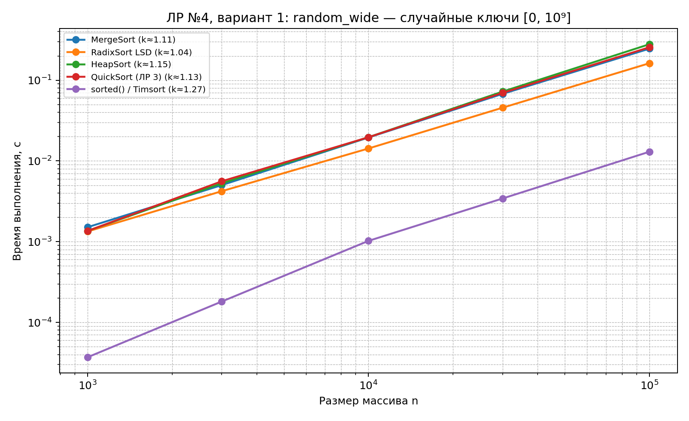
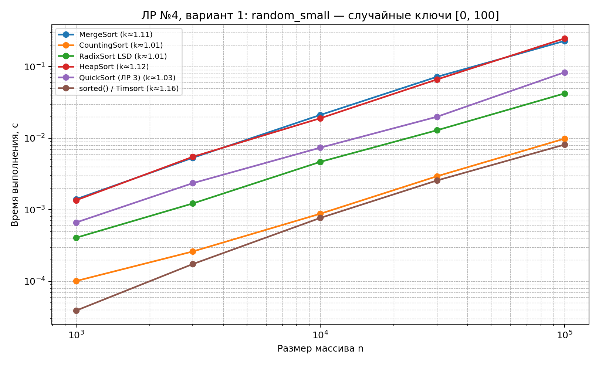
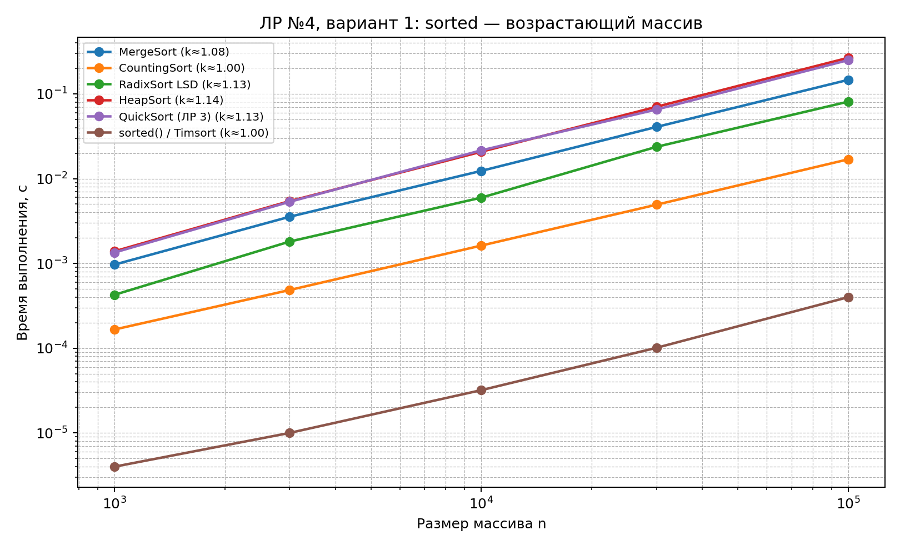
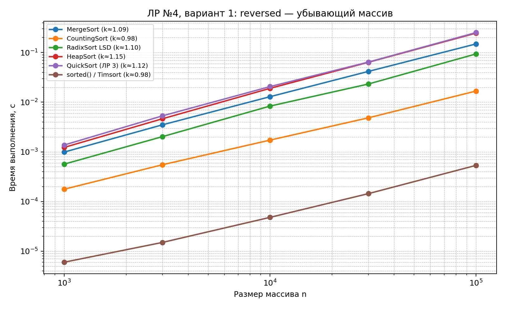
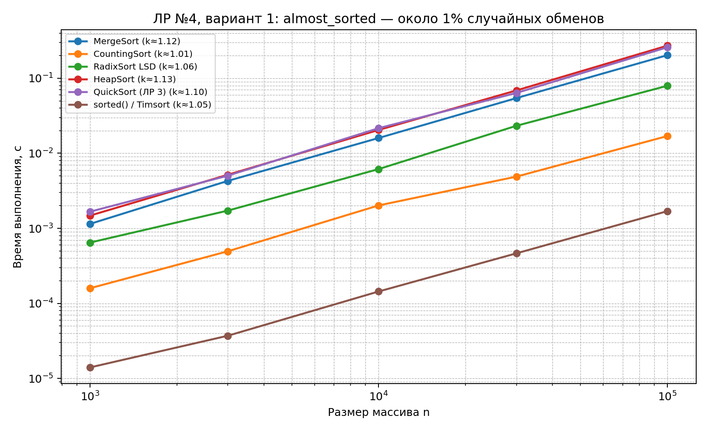

# Отчёт по лабораторной работе №4
**Тема:** MergeSort, Counting, Radix и HeapSort: оценка производительности  
**Вариант:** 1 (`seed = 31`)

---

## 1. Сводная таблица свойств алгоритмов сортировки

| Алгоритм | Лучший случай | Средний случай | Худший случай | Доп. память | Стабильность | Ограничения и особенности применимости |
|---|---:|---:|---:|---:|---|---|
| **`merge_sort`** | Θ(n log n) | Θ(n log n) | Θ(n log n) | O(n) | Да | Требует дополнительный буфер O(n) для слияния |
| **`counting_sort`** | Θ(n + k) | Θ(n + k) | Θ(n + k) | O(n + k) | Да | Целые ключи из [0, k]; невыгоден при k ≫ n |
| **`radix_sort_lsd`** | Θ(d(n + b)) | Θ(d(n + b)) | Θ(d(n + b)) | O(n + b) | Да | Неотрицательные целые; основание b = 10 |
| **`heap_sort`** | Θ(n log n) | Θ(n log n) | Θ(n log n) | O(1) | Нет | Сортирует на месте (`in-place`), но имеет плохую локальность кэша |
| **`quick_sort` (ЛР 3)** | Θ(n log n) | O(n log n) ожидаемо | O(n²) | O(log n) | Нет | Рандомизация опорного элемента снижает вероятность худшего случая |
| **`sorted()` (Timsort)** | Θ(n) | O(n log n) | O(n log n) | O(n) | Да | Использует естественные упорядоченные серии; реализация CPython на C |

Обозначения: n — количество элементов; k — размер диапазона ключей CountingSort; d — количество разрядов числа; b — основание системы счисления.

## 2. Верификация и проверка стабильности

Функция `self_check()` завершилась сообщением **`self_check: OK`**.

1. **Граничные случаи:** проверены пустой массив `[]`, массив из одного элемента, массив из одинаковых элементов и нулевой ключ.
2. **Стабильность MergeSort:** проверена на 100 парах `(ключ, порядковый_номер)` с повторяющимися ключами из диапазона [0, 5]. Результат совпал со стабильным эталоном `sorted(pairs, key=lambda p: p[0])`. Стабильность обеспечивается условием `key(left[i]) <= key(right[j])` в функции `merge()`.
3. **CountingSort и RadixSort:** в реализации используется обратный проход по входному массиву после построения префиксных сумм. Это сохраняет исходный порядок элементов с одинаковым ключом (для RadixSort — одинаковой цифрой текущего разряда).
4. **Случайные тесты:** проверены 200 массивов случайной длины от 0 до 60 со значениями от 0 до 999. Результаты всех пяти пользовательских алгоритмов совпали с `sorted(a)`.
5. **Инвариант перестановки:** совпадение с эталонной сортировкой подтверждает, что элементы не теряются и не добавляются. HeapSort дополнительно проверен как алгоритм, изменяющий исходный список на месте.

## 3. Результаты бенчмарка (медиана по 5 повторам с прогревом)

Измерения проводились для размеров n = 1 000, 3 000, 10 000, 30 000 и 100 000. Перед измерениями выполнялся один прогревочный запуск. Для каждого повтора создавалась копия входного массива; время измерялось через `time.perf_counter()`. В таблицах приведены медианы.

**Среда измерений:** Python 3.13.5, Linux 6.18.57, x86_64. Абсолютные значения времени могут отличаться на другом компьютере; сравнивать следует прежде всего относительные тенденции.

CountingSort не запускался на `random_wide`: при диапазоне ключей до 10⁹ ему потребовался бы массив счётчиков до 1 000 000 001 элемента. Только ссылки такого Python-списка заняли бы около 8 GB памяти на 64-битной платформе, не считая накладных расходов.

### 3.1. random_wide — случайные ключи [0, 10⁹]

| Алгоритм | n = 1 000 | n = 3 000 | n = 10 000 | n = 30 000 | n = 100 000 | Наклон k (log-log) |
|---|---:|---:|---:|---:|---:|---:|
| **`merge_sort`** | 0.001511 | 0.005014 | 0.019517 | 0.067780 | 0.246023 | 1.11 |
| **`counting_sort`** | — | — | — | — | — | — |
| **`radix_sort_lsd`** | 0.001338 | 0.004218 | 0.014278 | 0.045657 | 0.162446 | 1.04 |
| **`heap_sort`** | 0.001362 | 0.005279 | 0.019702 | 0.072321 | 0.279385 | 1.15 |
| **`quick_sort (ЛР 3)`** | 0.001359 | 0.005597 | 0.019670 | 0.069759 | 0.256035 | 1.13 |
| **`sorted() (эталон)`** | 0.000037 | 0.000181 | 0.001023 | 0.003427 | 0.013005 | 1.27 |

### 3.2. random_small — случайные ключи [0, 100]

| Алгоритм | n = 1 000 | n = 3 000 | n = 10 000 | n = 30 000 | n = 100 000 | Наклон k (log-log) |
|---|---:|---:|---:|---:|---:|---:|
| **`merge_sort`** | 0.001408 | 0.005323 | 0.021193 | 0.072207 | 0.229381 | 1.11 |
| **`counting_sort`** | 0.000101 | 0.000261 | 0.000881 | 0.002940 | 0.009870 | 1.01 |
| **`radix_sort_lsd`** | 0.000407 | 0.001224 | 0.004680 | 0.012925 | 0.042317 | 1.01 |
| **`heap_sort`** | 0.001361 | 0.005494 | 0.019055 | 0.066328 | 0.248427 | 1.12 |
| **`quick_sort (ЛР 3)`** | 0.000665 | 0.002354 | 0.007387 | 0.019954 | 0.083542 | 1.03 |
| **`sorted() (эталон)`** | 0.000039 | 0.000174 | 0.000770 | 0.002567 | 0.008145 | 1.16 |

### 3.3. sorted — возрастающий массив

| Алгоритм | n = 1 000 | n = 3 000 | n = 10 000 | n = 30 000 | n = 100 000 | Наклон k (log-log) |
|---|---:|---:|---:|---:|---:|---:|
| **`merge_sort`** | 0.000968 | 0.003549 | 0.012351 | 0.040711 | 0.146366 | 1.08 |
| **`counting_sort`** | 0.000166 | 0.000485 | 0.001624 | 0.004924 | 0.016894 | 1.00 |
| **`radix_sort_lsd`** | 0.000426 | 0.001808 | 0.005973 | 0.023712 | 0.080974 | 1.13 |
| **`heap_sort`** | 0.001389 | 0.005427 | 0.020769 | 0.070393 | 0.266450 | 1.14 |
| **`quick_sort (ЛР 3)`** | 0.001344 | 0.005323 | 0.021585 | 0.065329 | 0.250172 | 1.13 |
| **`sorted() (эталон)`** | 0.000004 | 0.000010 | 0.000032 | 0.000101 | 0.000400 | 1.00 |

### 3.4. reversed — убывающий массив

| Алгоритм | n = 1 000 | n = 3 000 | n = 10 000 | n = 30 000 | n = 100 000 | Наклон k (log-log) |
|---|---:|---:|---:|---:|---:|---:|
| **`merge_sort`** | 0.000990 | 0.003503 | 0.012920 | 0.041666 | 0.148907 | 1.09 |
| **`counting_sort`** | 0.000177 | 0.000550 | 0.001725 | 0.004844 | 0.016765 | 0.98 |
| **`radix_sort_lsd`** | 0.000566 | 0.002026 | 0.008355 | 0.023219 | 0.093633 | 1.10 |
| **`heap_sort`** | 0.001229 | 0.004640 | 0.019016 | 0.063601 | 0.245912 | 1.15 |
| **`quick_sort (ЛР 3)`** | 0.001374 | 0.005308 | 0.020646 | 0.064208 | 0.252135 | 1.12 |
| **`sorted() (эталон)`** | 0.000006 | 0.000015 | 0.000048 | 0.000144 | 0.000534 | 0.98 |

### 3.5. almost_sorted — около 1% случайных обменов

| Алгоритм | n = 1 000 | n = 3 000 | n = 10 000 | n = 30 000 | n = 100 000 | Наклон k (log-log) |
|---|---:|---:|---:|---:|---:|---:|
| **`merge_sort`** | 0.001145 | 0.004284 | 0.015992 | 0.054390 | 0.203034 | 1.12 |
| **`counting_sort`** | 0.000159 | 0.000494 | 0.002019 | 0.004888 | 0.016964 | 1.01 |
| **`radix_sort_lsd`** | 0.000646 | 0.001721 | 0.006161 | 0.023251 | 0.079384 | 1.06 |
| **`heap_sort`** | 0.001478 | 0.005173 | 0.020473 | 0.068835 | 0.271881 | 1.13 |
| **`quick_sort (ЛР 3)`** | 0.001666 | 0.005029 | 0.021623 | 0.063707 | 0.258722 | 1.10 |
| **`sorted() (эталон)`** | 0.000014 | 0.000037 | 0.000144 | 0.000464 | 0.001693 | 1.05 |

Полные измерения также сохранены в [`lab04-results/lab04_timings.csv`](lab04-results/lab04_timings.csv).

## 4. Графики и сопоставление с асимптотикой

### 4.1. random_wide — случайные ключи [0, 10⁹]

### 4.2. random_small — случайные ключи [0, 100]

### 4.3. sorted — возрастающий массив

### 4.4. reversed — убывающий массив

### 4.5. almost_sorted — около 1% случайных обменов

### Анализ результатов

1. **CountingSort и диапазон ключей.** На `random_small` диапазон ключей ограничен значениями [0, 100], поэтому k = 101 и затраты Θ(n + k) близки к линейным по n. При n = 100 000 время CountingSort составило 0.009870 с. Это примерно в 8.5 раза быстрее QuickSort (0.083542 с) и в 23.2 раза быстрее MergeSort (0.229381 с). На `random_wide` CountingSort пропущен из-за огромного диапазона ключей.
2. **RadixSort на широком диапазоне.** RadixSort использует десять счётчиков на каждом десятичном разряде, поэтому не выделяет массив размером с максимальный ключ. На `random_wide` при n = 100 000 время составило 0.162446 с — быстрее MergeSort, HeapSort и QuickSort в данном запуске.
3. **MergeSort и HeapSort.** Оба алгоритма сохраняют Θ(n log n) независимо от исходного порядка данных. MergeSort в этих измерениях оказался быстрее HeapSort. HeapSort использует O(1) дополнительной памяти, однако просейка требует многочисленных индексных обращений и обменов.
4. **QuickSort.** Рандомизированный pivot и трёхчастное разбиение обеспечивают ожидаемую производительность O(n log n). На массиве с повторяющимися ключами `random_small` трёхчастное разбиение группирует равные элементы за один проход разбиения.
5. **Встроенный `sorted()` / Timsort.** Он оказался самым быстрым во всех пяти распределениях. На n = 100 000 время составило 0.000400 с для возрастающего массива, 0.000534 с для обратного и 0.001693 с для почти отсортированного. Это связано с распознаванием естественных упорядоченных серий.
6. **Экспериментальные наклоны.** Для CountingSort на узком диапазоне наклон близок к 1.00, что согласуется с Θ(n + k) при небольшом k. Для MergeSort, HeapSort и QuickSort значения находятся примерно в диапазоне 1.08–1.15. На конечном диапазоне размеров алгоритмы Θ(n log n) могут давать log-log наклон немного выше единицы. Наклоны являются экспериментальной оценкой, а не доказательством асимптотики.

## 5. Выводы

1. MergeSort обеспечивает гарантированную Θ(n log n), сохраняет стабильность, но требует O(n) дополнительной памяти.
2. CountingSort наиболее эффективен при небольшом диапазоне целочисленных ключей. При k ≫ n затраты памяти и времени делают его неприменимым.
3. RadixSort LSD подходит для больших диапазонов неотрицательных целых чисел, если число разрядов ограничено; устойчивость каждого поразрядного прохода обязательна.
4. HeapSort выполняет сортировку на месте и гарантирует Θ(n log n), но в проведённых измерениях уступил MergeSort и QuickSort по времени.
5. QuickSort с рандомизированным выбором опорного элемента показал ожидаемое поведение O(n log n); трёхчастное разбиение полезно при большом количестве повторяющихся ключей.
6. Встроенный `sorted()` оказался быстрее пользовательских реализаций, особенно на отсортированных и почти отсортированных массивах.

## 6. Ответы на контрольные вопросы (раздел 10 КИМ-04)

### 1. Почему MergeSort стабилен и какое условие обеспечивает стабильность?

В функции `merge()` при равенстве ключей выбирается элемент левой половины по условию `key(left[i]) <= key(right[j])`. Элементы левой половины находились раньше элементов правой половины во входном массиве, поэтому исходный порядок равных ключей сохраняется.

### 2. Какие ограничения накладывает диапазон ключей на CountingSort?

Ключи должны быть целыми и лежать в известном неотрицательном диапазоне. Алгоритм выделяет массив из k счётчиков и обрабатывает n элементов, поэтому время и дополнительная память составляют Θ(n + k). При k ≫ n затраты на счётчики становятся слишком большими.

### 3. Чем RadixSort отличается от CountingSort и почему внутренний проход должен быть устойчивым?

CountingSort индексирует счётчики значениями ключей и требует O(n + k). RadixSort обрабатывает ключ по отдельным разрядам; при b = 10 каждый проход использует десять счётчиков, а общая сложность равна Θ(d(n + b)). Устойчивость прохода сохраняет порядок, установленный на предыдущих младших разрядах.

### 4. Почему HeapSort нестабилен, хотя работает за O(n log n) и in-place?

При извлечении максимума корень кучи меняется местами с последним элементом неотсортированной части. Такой обмен может перенести равный элемент через другой и изменить их исходный взаимный порядок. Сложность и работа на месте не гарантируют стабильность.

### 5. Как доказывается нижняя граница Ω(n log n) для сортировок сравнением и почему CountingSort и RadixSort её обходят?

Сортировка сравнением задаёт бинарное дерево решений с не менее чем n! листьями — по одному для каждой перестановки входа. Поэтому высота h удовлетворяет 2^h ≥ n!, откуда h ≥ log₂(n!) = Ω(n log n). CountingSort и RadixSort используют значения ключей и их разряды для адресации счётчиков, а не только попарные сравнения, поэтому при подходящих ограничениях могут работать за линейное по n время.

---

**Воспроизводимость:** из корня репозитория запустить `python M2-sorting/attachments/lab04-mergesort-linear-heapsort-starter.py --variant 1 --out M2-sorting/lab04-results`. Скрипт использует seed = 31, выполняет проверки, печатает результаты бенчмарка и сохраняет общий график `lab04_times.png`. CSV и пять отдельных графиков в этой папке — дополнительные материалы с измерениями, использованными в отчёте.
